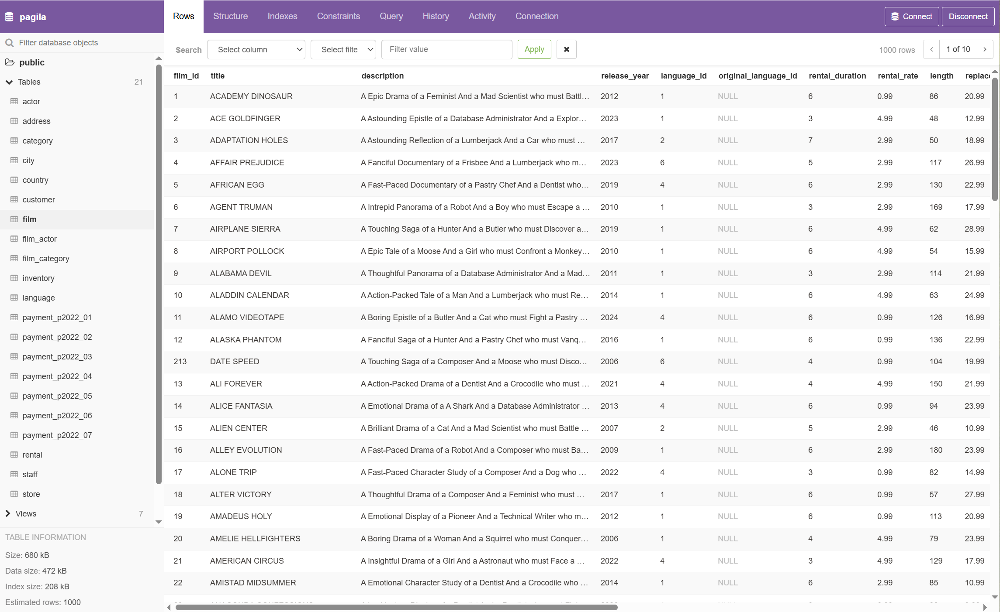
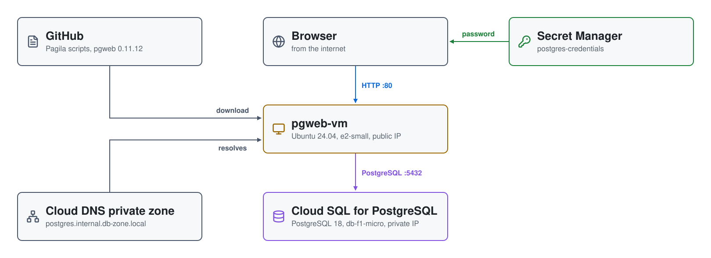

# PostgreSQL on GCP: Cloud SQL for PostgreSQL with pgweb

A private **Cloud SQL for PostgreSQL** instance, built with Terraform and
loaded with the
[Pagila](https://www.postgresql.org/ftp/projects/pgFoundry/dbsamples/pagila/)
sample database. The instance has no public IP; a **pgweb** VM with a public
IP gives you a browser client for it.



| Piece | Where | Role |
|---|---|---|
| **Cloud SQL for PostgreSQL** | private IP, peered to `postgres-vpc` | `postgres-instance`, PostgreSQL 18, `db-f1-micro`, automated backups, Sunday 03:00 maintenance window; no public IP |
| **Private service access** | `postgres-vpc` | a reserved /16 range peered to Google's service network, which is where the instance's private IP comes from |
| **Cloud DNS private zone** | visible to `postgres-vpc` | `internal.db-zone.local`, with `postgres.internal.db-zone.local` pointing at the instance |
| **pgweb-vm** | `postgres-subnet`, public IP | Ubuntu 24.04, `e2-small`, `us-central1-a`; loads Pagila, then serves pgweb 0.11.12 on port 80 |
| **Secret Manager** | global | `postgres-credentials`: the `postgres` user and password |

## Architecture

<picture>
  <source media="(prefers-color-scheme: dark)" srcset="architecture-dark.svg">
  
</picture>

Regenerate with `python3 make_diagram.py`.

- **`01-postgres/`** is the whole stack: the VPC (`postgres-vpc`) with
  `postgres-subnet` (10.0.0.0/24), the firewall rules, the private service
  access range and peering, the Cloud SQL instance and its `postgres` user,
  the private DNS zone, the secret, and the pgweb VM.
- **`01-postgres/data/`** holds the Pagila load scripts (`pagila-db.sql`,
  `pagila-schema.sql`, `pagila-data.sql`) and the sample queries.

## How it boots

1. Terraform builds the VPC and the private service access peering, then
   waits 5 minutes for the peering to propagate before creating the Cloud SQL
   instance. It generates a 24-character password for the `postgres` user.
2. The VM's startup script installs the PostgreSQL client, clones this
   repository, and loads Pagila into `postgres.internal.db-zone.local` with
   `psql`. Output is in `/tmp/db_load.log`.
3. It downloads pgweb 0.11.12 from GitHub and runs it as a systemd service on
   port 80. pgweb starts without a connection; you enter one when you open it.

## Firewall rules

```
internet ─80, 22─▶ pgweb-vm ─5432─▶ Cloud SQL (peered private IP)
```

| Rule | Port | Applies to |
|---|---|---|
| `postgres-allow-http` | tcp 80 | pgweb-vm |
| `postgres-allow-ssh` | tcp 22 | pgweb-vm |

Both allow `0.0.0.0/0`. The Cloud SQL instance has no public IP, so it can
only be reached from inside the VPC.

## Prerequisites

* [A Google Cloud Account](https://console.cloud.google.com/)
* [Install gcloud CLI](https://cloud.google.com/sdk/docs/install)
* [Install Terraform](https://developer.hashicorp.com/terraform/install)
* [Install jq](https://jqlang.github.io/jq/download/)

Put a service account key in the repository root as `credentials.json`.
Terraform uses it, and `check_env.sh` activates it and runs `api_setup.sh`,
which enables the Cloud SQL Admin, Service Networking, Compute and other APIs
the build needs. If this is your first time watching our content, we
recommend starting with this video:
[GCP + Terraform: Easy Setup](https://youtu.be/3spJpYX4f7I).

## Deploy

```bash
git clone https://github.com/mamonaco1973/gcp-postgres.git
cd gcp-postgres
./apply.sh       # one phase: VPC, peering, Cloud SQL, DNS, secret, pgweb VM
```

Everything deploys to `us-central1`. `apply.sh` ends by running
`validate.sh`, which waits for pgweb to answer (up to 15 minutes) and prints:

```
===============================================================================
BUILD RESULTS
===============================================================================
pgweb URL             : http://203.0.113.10
Postgres Hostname DNS : postgres.internal.db-zone.local
===============================================================================
```

## Try it

1. Get the password from Secret Manager:

   ```bash
   gcloud secrets versions access latest --secret=postgres-credentials \
     | jq -r .password
   ```

2. Open the pgweb URL and connect with host
   `postgres.internal.db-zone.local`, user `postgres`, that password, and
   database `pagila`.
3. Run the sample queries from the **Query** tab (`01-postgres/data/`):

   ```sql
   SELECT
       f.title AS film_title,
       a.first_name || ' ' || a.last_name AS actor_name
   FROM film f
   JOIN film_actor fa ON f.film_id = fa.film_id
   JOIN actor a ON fa.actor_id = a.actor_id
   ORDER BY f.title, actor_name
   LIMIT 20;
   ```

   ```sql
   SELECT
       f.title,
       STRING_AGG(a.first_name || ' ' || a.last_name, ', ') AS actor_names
   FROM film f
   JOIN film_actor fa ON f.film_id = fa.film_id
   JOIN actor a ON fa.actor_id = a.actor_id
   GROUP BY f.title
   ORDER BY f.title
   LIMIT 10;
   ```

## Troubleshooting

| Symptom | Fix |
|---|---|
| `validate.sh` keeps retrying | The VM is still installing. `gcloud compute ssh pgweb-vm --zone us-central1-a`, then `sudo journalctl -u google-startup-scripts`. |
| `pagila` is missing | Read `/tmp/db_load.log` on the VM for the `psql` output. |
| pgweb can't reach the server | `nslookup postgres.internal.db-zone.local` on the VM should return the instance's private IP. |
| You want a local client | The instance is private. Connect from the VM (`psql -h postgres.internal.db-zone.local -U postgres -d pagila`). |

## Teardown

```bash
./destroy.sh     # deletes the Cloud SQL instance with gcloud first, then destroys the stack
```

The instance is deleted first so that Terraform can then remove the private
service access peering.

## Notes

- **Lab only.** pgweb is open to the internet over plain HTTP with no
  sign-in of its own and runs as root, SSH is open from anywhere, the
  database password is in the VM's startup script metadata, and the VM runs
  as the same service account as Terraform with the `cloud-platform` scope.
  Restrict the firewall rules and use a narrower VM service account for
  anything more.
